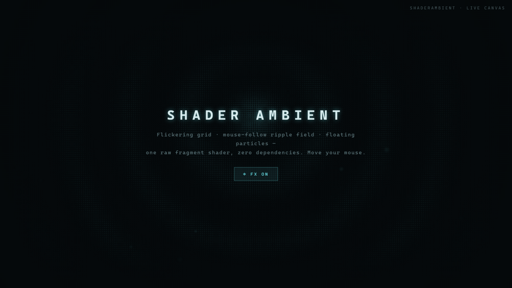

<div align="center">

# ShaderAmbient

**零依赖 WebGL 氛围背景 —— 一个原始片元着色器画出闪烁网格、鼠标涟漪场与上浮粒子，性能保护齐全。**

[](./LICENSE)
[](./.github/workflows/ci.yml)

[English](./README.md)

</div>

---

> ▶ **在线演示：[www.hackerenglish.com](https://www.hackerenglish.com)** —— 站点的氛围背景正是本 shader 的生产环境运行效果。

暗色科技风落地页的"氛围背景"通常是 three.js demo：重、固执己见，而且没考虑带不动的笔记本。ShaderAmbient 是一个原始片元着色器（约 330 行、零依赖），并且**把无聊但重要的部分做对了**：
<div align="center">
  
</div>


```tsx
import { ShaderAmbience } from "shader-ambient";

// 固定在应用背后、不响应指针的 canvas
<ShaderAmbience color="#66d9e0" intensity={0.03} />
```

## 特性

- **一个着色器，三层动画** —— 闪烁网格 + 鼠标跟随圆点涟漪场 + 上浮粒子，边缘暗角合成，不抢正文可读性。
- **零依赖** —— 原生 WebGL，没有 three.js、没有 regl。core 就是单个文件。
- **性能保护齐全** —— DPR 上限 2、canvas 上限 4096px、low-power 上下文、IntersectionObserver 离屏暂停、`prefers-reduced-motion` 渲染静态帧。
- **定格模式** —— `enabled={false}` 把动画停在当前帧：GPU 计算归零、画面保留。配合持久化的 `useFxPreference()` 开关使用。
- **SSR 安全** —— 浏览器 API 全部守卫；服务端什么都不跑。

## 安装

```bash
npm install shader-ambient
```

| 技术栈 | 导入 |
| --- | --- |
| React / Next.js | `import { ShaderAmbience } from "shader-ambient"` |
| 任意框架 / 纯 JS | `import { createShaderAmbience } from "shader-ambient/core"` |

## 用法

### React

```tsx
import { ShaderAmbience, useFxPreference, requestFx } from "shader-ambient";

function App() {
  const fx = useFxPreference(); // 持久化开关（localStorage）
  return (
    <>
      <ShaderAmbience enabled={fx} color="#66d9e0" intensity={0.03} />
      <button onClick={() => requestFx(!fx)}>特效 {fx ? "开" : "关"}</button>
      {/* 你的内容 */}
    </>
  );
}
```

### 框架无关

```ts
import { createShaderAmbience } from "shader-ambient/core";

const handle = createShaderAmbience(canvas, {
  color: "#66d9e0",
  intensity: 0.03,
  gridLines: 40,
  dotScale: 150,
  vignette: true,
  mouseInteractive: true,
});
if (handle) {
  handle.setEnabled(false); // 定格
  handle.destroy();         // 解除监听
}
```

WebGL 不可用或着色器编译失败时返回 `null`——降级方案由你决定（一层 CSS 渐变就很合适）。

### 选项

| 选项 | 默认值 | 说明 |
| --- | --- | --- |
| `color` | `#66d9e0` | 主题色（hex） |
| `gridLines` | `40` | 网格密度 |
| `dotScale` | `150` | 圆点场密度 |
| `intensity` | `0.03` | 整体亮度——保持氛围级，别和内容打架 |
| `vignette` | `true` | 边缘渐隐 |
| `mouseInteractive` | `true` | 涟漪辉光跟随指针 |
| `onUnavailable` | — | WebGL / 编译失败时回调 |

## 来源

抽取自 HackerEnglish 项目——着色器原型改编自 Bitget builder-section demo，性能保护由 HackerEnglish 补齐。见 [`docs/PORTING.md`](./docs/PORTING.md)。

## 许可

[MIT](./LICENSE)。
